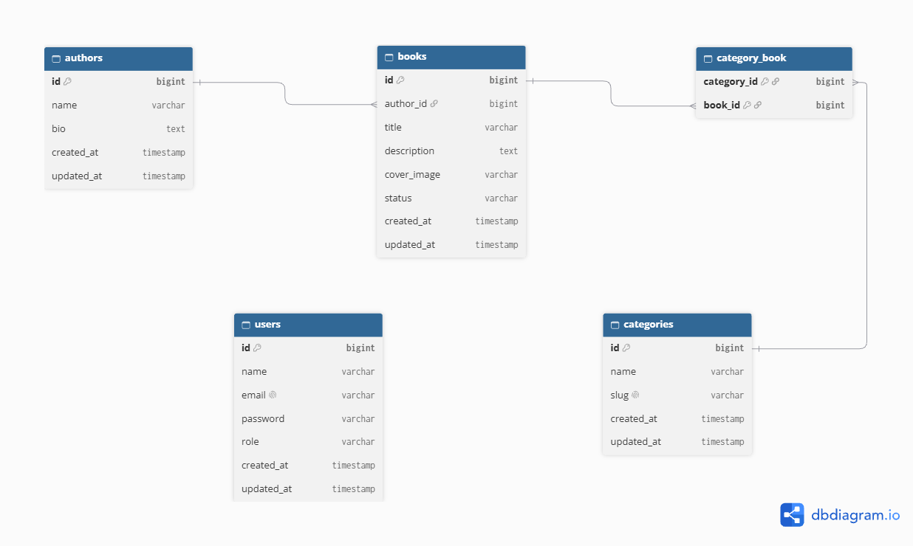

# 📚 Laporan Praktikum Pemrograman Berbasis Web - Praktikum 8


## 👤 Informasi Mahasiswa

* **Nama:** Kholil Irsyad Marwan
* **NPM:** 4524210110
* **Mata Kuliah:** Pemrograman Berbasis Web (PBW) - Kelas A
* **Tugas:** Laporan Praktikum PBW - Pertemuan 8
* **Dosen Pengampu:** Bambang Riono Arsad, S.Kom., MMSI
* **Program Studi:** Teknik Informatika
* **Fakultas:** Teknik
* **Instansi:** Universitas Pancasila
* **Tahun Akademik:** 2026/2027
---
## 🚀 Instalasi & Penggunaan
### 1. Clone Repository
Buka Terminal / Command Prompt dan jalankan perintah:
```bash
git clone [https://github.com/KholilIrsyadMarwan/4524210110-KHOLILIRSYADMARWAN-PBW-A-Praktikum8.git](https://github.com/KholilIrsyadMarwan/4524210110-KHOLILIRSYADMARWAN-PBW-A-Praktikum8.git)
cd 4524210110-KHOLILIRSYADMARWAN-PBW-A-Praktikum8
```
### 2.Install Dependensi
```bash
composer install
npm install && npm run build
```
### 3. Salin File Konfigurasi
```bash
copy .env.example .env
```
### 4. Generate Application Key & Menjalankan Migration
```bash
php artisan key:generate
php
```

### 5. Buat Storage Link
```bash
php artisan storage:link
```

### 6. Jalankan Server Lokal
```bash
php artisan serve
```
---

## 📑 DAFTAR ISI

- [BAB I PENDAHULUAN](#bab-i-pendahuluan)
  - [1.1 Latar Belakang](#11-latar-belakang)
- [BAB II PENJELASAN ARSITEKTUR](#bab-ii-penjelasan-arsitektur)
  - [2.1 Aplikasi Ini Tersusun dari Apa Saja](#21-aplikasi-ini-tersusun-dari-apa-saja)
  - [2.2 Diagram ERD](#22-diagram-erd)
  - [2.3 Hubungan Antar Tabel](#23-hubungan-antar-tabel)
  - [2.3.1 Hak Akses](#231-hak-akses)
  - [2.4 Alur Aplikasi: dari Klik sampai Tampil](#24-alur-aplikasi-dari-klik-sampai-tampil)
  - [2.5 Dashboard](#25-dashboard)
- [BAB III PERBANDINGAN DENGAN PENDEKATAN TRADISIONAL](#bab-iii-perbandingan-dengan-pendekatan-tradisional)
  - [3.1 Beda Membuat CRUD Manual dan dengan Filament](#31-beda-membuat-crud-manual-dan-dengan-filament)
  - [3.2 Kelebihan dan Kekurangan](#32-kelebihan-dan-kekurangan)
    - [3.2.1 Filament](#321-filament)
    - [3.2.2 CRUD Manual](#322-crud-manual)
    - [3.2.3 Kapan Memakai Filament dan Kapan Tidak](#323-kapan-memakai-filament-dan-kapan-tidak)
- [BAB IV REFLEKSI PEMBELAJARAN & PENUTUP](#bab-iv-refleksi-pembelajaran--penutup)
  - [4.1 Apa yang Saya Pelajari](#41-apa-yang-saya-pelajari)
  - [4.2 Kesulitan dan Cara Mengatasinya](#42-kesulitan-dan-cara-mengatasinya)
  - [4.3 Rencana Pengembangan Selanjutnya](#43-rencana-pengembangan-selanjutnya)
  - [4.4 Kesimpulan](#44-kesimpulan)

---

## BAB I PENDAHULUAN

### 1.1 Latar Belakang
Authbook adalah aplikasi admin untuk mengelola perpustakaan kecil: data buku, penulis, dan kategori. Aplikasi ini dibuat dengan **Laravel 12** dan **Filament 3**, datanya disimpan di **SQLite**, dan dibuka lewat alamat `/admin`.

Lewat aplikasi ini, admin bisa menambah, melihat, mengubah, dan menghapus data buku, penulis, dan kategori. Buku bisa dicari, diurutkan, dan disaring berdasarkan status, tahun, atau penulis, lengkap dengan gambar sampul (JPEG, PNG, atau WebP, maksimal 2 MB) dan halaman detail. Satu buku punya satu penulis dan bisa masuk ke beberapa kategori, hak akses dibagi untuk tiga jenis pengguna (admin, staff, dan viewer), dan dashboard menampilkan ringkasan jumlah buku dan penulis serta grafik status buku.

Laporan ini menjelaskan cara kerja aplikasi (Bagian 2), membandingkannya dengan cara membuat CRUD secara manual (Bagian 3), dan berisi refleksi saya selama mengerjakan praktikum.

---

## BAB II PENJELASAN ARSITEKTUR

### 2.1 Aplikasi Ini Tersusun dari Apa Saja
Authbook memakai pola **MVC (Model, View, Controller)** dari Laravel. Bedanya, Filament mengambil alih sebagian besar pekerjaan Controller dan View, jadi kita tidak perlu membuat halamannya satu per satu.

| Bagian | Letaknya | Fungsinya |
| :--- | :--- | :--- |
| **Model** | `app/Models` | Wakil tabel di dalam kode: `Author`, `Book`, `Category`, `User` |
| **Migration** | `database/migrations` | "Resep" untuk membuat dan mengubah tabel |
| **Factory dan Seeder** | `database/factories`, `database/seeders` | Pembuat data contoh: 10 penulis, 50 buku, 10 kategori, dan 3 akun |
| **Resource** | `app/Filament/Resources` | Pengatur satu jenis data (form, tabel, filter, tombol). Ini pengganti Controller dan View |
| **Page** | `app/Filament/Resources/*/Pages` | Halaman daftar, tambah, ubah, dan detail |
| **Widget** | `app/Filament/Widgets` | Kotak ringkasan di dashboard |
| **Policy** | `app/Policies` | Aturan siapa boleh melakukan apa |
| **Panel Provider** | `app/Providers/Filament/AdminPanelProvider.php` | Pengaturan panel admin: alamat `/admin`, halaman login, warna, dan pendaftaran otomatis resource dan widget |

---

### 2.2 Diagram ERD



---

### 2.3 Hubungan Antar Tabel

| Tabel | Primary Key | Foreign Key | Keterangan Relasi |
| :--- | :--- | :--- | :--- |
| **authors** | `id` | - | Memiliki relasi Has Many ke `books`. |
| **books** | `id` | `author_id` → `authors.id` | Belongs To `authors`, serta Belongs To Many `categories` via `category_book`. |
| **categories** | `id` | - | Belongs To Many `books` via `category_book`. |
| **category_book** | `(category_id, book_id)` | `category_id`, `book_id` | Tabel perantara (Pivot Table) relasi N : M. |

#### 2.3.1 Hak Akses

| Aksi | Admin | Staff | Viewer |
| :--- | :---: | :---: | :---: |
| Melihat daftar dan detail | Ya | Ya | Ya |
| Menambah dan mengubah | Ya | Ya | Tidak |
| Menghapus, termasuk hapus banyak sekaligus | Ya | Tidak | Tidak |
| Restore dan hapus permanen | Ya | Tidak | Tidak |

---

### 2.4 Alur Aplikasi: dari Klik sampai Tampil

Bagian ini menjelaskan apa yang terjadi di balik layar pada dua kejadian umum.

#### Skenario A: Membuka Daftar Buku (`/admin/books`)
1. Browser mengirim permintaan ke `public/index.php`, pintu masuk semua permintaan ke aplikasi Laravel.
2. Alamat `/admin` sudah didaftarkan oleh `AdminPanelProvider`. Permintaan melewati beberapa "penjaga" (middleware), misalnya pengelola cookie, sesi, dan token keamanan CSRF.
3. Penjaga `Authenticate` mengecek apakah pengguna sudah login. Kalau belum, pengguna diarahkan ke `/admin/login`.
4. Alamat `/admin/books` diarahkan ke halaman `ListBooks`.
5. Filament mengecek `BookPolicy::viewAny()`. Kalau tidak diizinkan, yang muncul halaman 403.
6. Filament membaca definisi `table()` di `BookResource`, lalu mengubahnya menjadi query ke tabel `books` (lengkap dengan data penulis dan kategori), termasuk pencarian, filter, urutan, dan pembagian halaman.
7. Hasilnya dirender menjadi HTML dan dikirim ke browser.
8. Setelah itu, saat pengguna mengetik di kotak pencarian atau memilih filter, Livewire mengirim permintaan kecil ke `/livewire/update` di latar belakang. Hanya bagian yang berubah yang diperbarui, tanpa memuat ulang seluruh halaman.

#### Skenario B: Menambah Buku Baru (`/admin/books/create`)
1. Halaman form muncul kalau `BookPolicy::create()` mengizinkan (admin atau staff). Isi form dibuat dari `BookResource::form()`.
2. Saat gambar sampul dipilih, Livewire mengunggahnya lebih dulu ke folder sementara `storage/app/private/livewire-tmp`.
3. Saat tombol Create ditekan, Filament mengecek isian: wajib diisi, panjang maksimal, ISBN tidak boleh kembar, rentang tahun, serta jenis dan ukuran gambar. Kalau ada yang salah, pesan error muncul di bawah kolom yang bermasalah.
4. Kalau semuanya benar, gambar dipindah ke `storage/app/public/book-covers` dan alamatnya disimpan di kolom `cover`. Gambar bisa dibuka lewat `public/storage` karena perintah `php artisan storage:link`.
5. Data buku disimpan ke tabel `books`, lalu kategori yang dipilih disimpan ke tabel `category_book`.
6. Pengguna dikembalikan ke halaman berikutnya dengan notifikasi berhasil.

---

### 2.5 Dashboard
Dashboard punya dua widget yang ditemukan otomatis oleh panel:
* **Library StatsOverview:** Menampilkan total buku, total penulis, dan jumlah buku yang tersedia (lengkap dengan jumlah yang sedang dipinjam).
* **BookStatusChart:** Menampilkan grafik donat yang membandingkan buku *available* dan *borrowed*. 

Semua angkanya dihitung langsung dari tabel `books` dan `authors`.

---

## BAB III PERBANDINGAN DENGAN PENDEKATAN TRADISIONAL

### 3.1 Beda Membuat CRUD Manual dan dengan Filament

CRUD adalah singkatan dari Create, Read, Update, Delete: menambah, melihat, mengubah, dan menghapus data. Kalau dibuat manual (Laravel dengan Blade), setiap bagiannya ditulis satu per satu dan jumlah filenya banyak. Dengan Filament, sebagian besar cukup dideklarasikan dalam satu Resource.

| Kebutuhan | Cara manual (Controller + Blade) | Dengan Filament (di authbook) |
| :--- | :--- | :--- |
| **Rute (alamat halaman)** | Ditulis sendiri di `routes/web.php` | Dibuat otomatis dari `getPages()` |
| **Controller** | Menulis `index`, `create`, `store`, `show`, `edit`, `update`, `destroy` | Tidak perlu; ditangani halaman Resource |
| **Validasi isian form** | Dibuat terpisah dari form (`FormRequest` atau `validate()`) | Satu tempat dengan form: `required()`, `unique()`, `maxLength()` |
| **Tampilan** | Minimal 4 file Blade plus layout | Tidak perlu; tampilan dibuat dari `form()`, `table()`, dan `infolist()` |
| **Cari, urutkan, pembagian halaman** | Query dan tampilannya dibuat sendiri | `searchable()`, `sortable()`, dan pagination bawaan |
| **Filter** | Form filter dan query dibuat sendiri | `SelectFilter::make('status')` dan sejenisnya |
| **Upload file** | Mengurus file, validasi, penyimpanan, dan pratinjau sendiri | `FileUpload::make('cover')->image()->maxSize(2048)` |
| **Memilih relasi di form** | Mengambil data dropdown dan menyimpan relasi sendiri | `Select::make('author_id')->relationship('author', 'name');` kategori otomatis tersimpan ke tabel penghubung |
| **Hak akses** | `authorize()` atau `@can` di tiap controller dan tampilan | Policy dibaca otomatis; tombol disembunyikan sesuai role |
| **Login dan layout admin** | Dibuat sendiri | `login()` dan layout admin sudah tersedia |
| **Dashboard** | Dibuat sendiri dengan library grafik | Cukup class widget dengan `getStats()` atau `getData()` |

Di AuthBook, satu file `BookResource.php` sudah mengurus form, tabel, pencarian, tiga filter, tombol aksi, hapus banyak sekaligus, upload cover, dan relasi. Kalau dibuat manual, semua itu tersebar di controller, form request, beberapa tampilan, rute, dan JavaScript.

---

### 3.2 Kelebihan dan Kekurangan

#### 3.2.1 Filament

| Kelebihan | Kekurangan |
| :--- | :--- |
| Cepat: CRUD lengkap cukup dalam satu file | Harus belajar Filament, Livewire, dan aturan mainnya |
| Tampilan rapi, konsisten, dan responsif tanpa mendesain dari nol | Tampilan terikat gaya bawaan; mengubahnya banyak butuh paham Blade, Livewire, dan Tailwind |
| Validasi, hak akses, dan relasi sudah menyatu | Bergantung pada versi package; fitur lama bisa usang (contoh: `BadgeColumn` sudah deprecated di Filament 3) |
| Kodenya lebih sedikit sehingga mudah dirawat | Kurang cocok untuk halaman publik dengan desain khusus |
| Fitur tambahan lengkap (widget, notifikasi, infolist, plugin) | Livewire sering memanggil server, jadi data yang sangat besar perlu perhatian pada kecepatan |

#### 3.2.2 CRUD Manual

| Kelebihan | Kekurangan |
| :--- | :--- |
| Bebas mengatur HTML, alur, dan perilaku | Lebih lama dan banyak kode yang berulang |
| Mudah dipahami karena langsung ke dasar MVC | Tampilan dan validasi bisa tidak seragam kalau kurang disiplin |
| Tidak bergantung pada package admin | Mudah ada yang terlewat, misalnya lupa validasi atau hak akses di satu halaman |
| Cocok untuk desain unik dan halaman publik | Filter, hapus banyak, dan dashboard harus dibuat dari nol |

#### 3.2.3 Kapan Memakai Filament dan Kapan Tidak

* **Pakai Filament** jika membuat panel admin, dashboard internal, aplikasi yang isinya kebanyakan CRUD, atau prototipe yang harus cepat jadi. AuthBook cocok dengan semua itu: datanya sederhana (buku, penulis, kategori), penggunanya staf internal, dan kebutuhannya hanya tabel, form, filter, dan hak akses.
* **Pertimbangkan cara lain** jika membuat situs publik dengan desain khusus (misalnya katalog buku untuk pengunjung), aplikasi dengan alur tampilan yang sangat khusus, atau aplikasi mobile (lebih cocok memakai API plus framework mobile). Cara manual juga lebih baik kalau tujuan utamanya belajar dasar MVC tanpa bantuan.

---

## BAB IV REFLEKSI PEMBELAJARAN & PENUTUP

### 4.1 Apa yang Saya Pelajari

1. **Struktur proyek Laravel dan pola MVC.** Alur dari model, migration, factory, seeder, sampai tampilan jadi lebih jelas karena saya membangun satu aplikasi utuh.
2. **Migration yang bertahap.** Kolom `description` dan `role` saya tambahkan lewat migration baru (`add_description_to_books_table` dan `add_role_to_users_table`), bukan dengan mengubah migration lama. Dengan begitu data tidak hilang dan perubahan bisa dibatalkan.
3. **Relasi Eloquent.** Saya mempraktikkan relasi satu ke banyak (`hasMany` dan `belongsTo`) serta banyak ke banyak (`belongsToMany` dengan tabel penghubung).
4. **Filament Resource.** Form, tabel, filter, tombol aksi, hapus banyak, halaman detail, dan upload file cukup ditulis lewat kode yang singkat.
5. **Policy.** Aturan admin, staff, dan viewer ditulis sekali, lalu Filament menyesuaikan tampilan otomatis.
6. **Factory, seeder, dan widget.** Data contoh bisa dibuat banyak sekaligus, dan dashboard meringkas datanya.
7. **Isi database.** Ternyata file SQLite punya 13 tabel. Delapan di antaranya adalah tabel sistem Laravel (sesi, cache, antrean) yang tidak saya buat sendiri.

---

### 4.2 Kesulitan dan Cara Mengatasinya

| Kesulitan | Penyebabnya | Cara Mengatasinya |
| :--- | :--- | :--- |
| Akun hasil seeder hanya bisa melihat data | Kolom `role` bernilai bawaan `viewer`, dan `DatabaseSeeder` tidak memanggil `UserSeeder` maupun `CategorySeeder` | Membuat `UserSeeder` berisi admin, staff, dan viewer, lalu menjalankannya terpisah: `php artisan db:seed --class=UserSeeder` (dan `CategorySeeder` untuk kategori) |
| Tombol hapus banyak sekaligus tidak muncul untuk role tertentu | Hapus banyak mengecek method `deleteAny`, bukan hanya `delete` | Menambahkan `deleteAny` di ketiga Policy dan membatasinya untuk admin |
| Gambar sampul tidak tampil atau gagal diunggah | Symlink storage belum dibuat, atau folder tidak bisa ditulis | Menjalankan `php artisan storage:link` dan memastikan izin folder storage |
| Perlu kolom baru padahal tabel sudah berisi data | Kalau pakai `migrate:fresh`, semua data terhapus | Memakai migration tambahan (`Schema::table`) |
| Halaman 404 atau pengaturan tidak terbaca setelah ada perubahan | Cache konfigurasi, rute, atau tampilan masih lama | Menjalankan `php artisan optimize:clear` |
| Memilih kategori sekaligus menambah kategori baru dari form buku | Relasi banyak ke banyak harus ada di model dulu sebelum dipakai di form | Membuat method `categories()` di Book, lalu memakai `Select::make('categories')->relationship()->multiple()->createOptionForm()` dengan aturan unique pada nama kategori |

---

### 4.3 Rencana Pengembangan Selanjutnya

1. **Fitur peminjaman.** Status buku sekarang hanya *available* atau *borrowed*. Tabel `loans` (anggota, buku, tanggal pinjam, jatuh tempo, tanggal kembali) akan membuat status berubah otomatis dan menyimpan riwayat peminjaman.
2. **Gambar sampul bawaan.** Kode memanggil `/images/default-book-cover.png`, tapi folder `public/images` belum berisi file itu. Menambahkannya akan merapikan buku yang belum punya sampul.
3. **Mengganti komponen yang sudah usang.** `BadgeColumn` diganti dengan `TextColumn::make('status')->badge()` agar sesuai Filament 3 terbaru.
4. **Seeder yang lengkap.** `DatabaseSeeder` memanggil `UserSeeder` dan `CategorySeeder`, dan factory buku langsung menghubungkan buku dengan kategori, supaya `php artisan migrate:fresh --seed` langsung menghasilkan data demo yang utuh.
5. **Pengujian otomatis.** Menulis *feature test* untuk Policy (admin, staff, viewer) dan relasi model agar perubahan ke depan tidak merusak hak akses.
6. **Katalog publik.** Halaman publik (Blade atau Livewire) supaya pengunjung bisa mencari buku tanpa login, sementara Filament tetap dipakai untuk pengelolaan.
7. **Role yang lebih rapi dan siap rilis.** Memindahkan role ke enum atau package permission, dan menyiapkan deployment dengan MySQL serta pengaturan `.env` produksi.

---

### 4.4 Kesimpulan

Praktikum ini menunjukkan bahwa Filament mempercepat pembuatan aplikasi CRUD tanpa menghilangkan dasar-dasar Laravel. Model, migration, relasi, validasi, dan Policy tetap harus ditulis dan dipahami; yang dipercepat hanya bagian tampilannya. Untuk aplikasi seperti AuthBook, Filament adalah pilihan yang efisien. Untuk kebutuhan yang lebih khusus, cara manual atau gabungan keduanya tetap layak dipertimbangkan.
